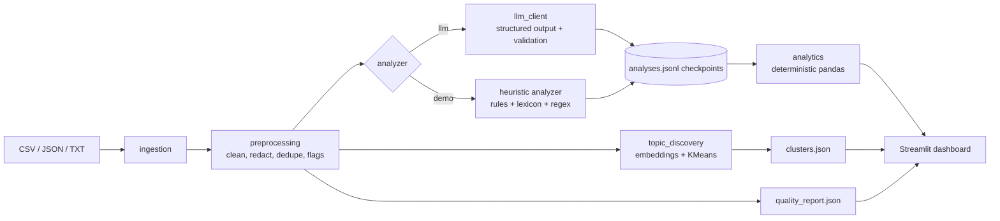

# TranscriptIQ — Conversation Intelligence

Turns B2B SaaS call transcripts (support, external, internal) into evidence-backed business intelligence:
topic themes, sentiment by call type, and stakeholder insights (renewal-risk signals, feature demand, engineering blockers).
Runs locally. Production deployment is out of scope.

> **Provenance.** No real transcripts ship with this repo. `data/synthetic/` holds exactly 100 **synthetic, template-generated**
> demo calls (40 support, 35 external customer, 25 internal engineering; invented companies, dates and people). Results computed
> from it are **not company findings**. Separate `ground_truth.csv` / `ground_truth.json` files contain scenario-designed topic
> and sentiment labels for evaluation; they are not human-reviewed and are never included in the transcript input. Every call
> carries `data_origin`, the dashboard never mixes origins, and run metadata states the analysis mode.
>
> **Two analysis modes.** `--mode llm` uses the OpenAI API (structured outputs, validated). `--mode demo` is a **heuristic**
> (keyword rules + sentiment lexicon + regex extraction) so everything runs without a key; it is *not* an LLM and is labeled everywhere.
> LLM mode never fabricates results: without `OPENAI_API_KEY` it stops with a setup error.

## Setup (Windows PowerShell)

```powershell
cd transcript-intelligence
py -3.11 -m venv .venv
.\.venv\Scripts\Activate.ps1          # if blocked: Set-ExecutionPolicy -Scope Process Bypass
pip install -r requirements.txt
Copy-Item .env.example .env           # then edit .env and set OPENAI_API_KEY (LLM mode only)
```

macOS/Linux: `python3 -m venv .venv && source .venv/bin/activate`, then the same `pip` / `cp` commands.

Environment variables (`.env`): `OPENAI_API_KEY`, `OPENAI_MODEL` (default `gpt-4o-mini`), optional `OPENAI_TEMPERATURE`
(only sent if set; some reasoning models reject it), `OPENAI_TIMEOUT`, `OPENAI_MAX_RETRIES`. Never commit `.env`.

## Input formats

Put files in `data/raw/` (git-ignored): `.csv`, `.json` (list, or `{"transcripts": [...]}`), `.jsonl`, `.txt` (one transcript per file),
or folders of these. Recognized columns/keys (case-insensitive): `transcript_id|id|call_id`, `call_type|type|category`,
`call_date|date|timestamp`, `transcript_text|transcript|text|content`, `customer_id|account_id`, `data_origin|origin`.
Transcript text should use `Speaker: text` lines; JSON may also give a list of `{speaker, text}` turns.

- Missing call type is inferred from a folder/file name containing `support|external|internal` and **flagged** `call_type_inferred`; otherwise `unknown`.
- Missing ids are generated and flagged `id_generated`. Missing dates stay missing. Nothing else is invented.
- Records in a path containing a `synthetic` folder get `data_origin=synthetic`; override with `--origin`.
- Empty and duplicate records are excluded from analysis but counted, with examples, in the data-quality report.

## Run

```powershell
python main.py generate-synthetic                 # regenerate the 100-call synthetic demo set and separate labels
python main.py run --mode demo                    # heuristic demo, no API key
python main.py run --mode llm --limit 3           # SMOKE-TEST the LLM path on 3 transcripts first
python main.py run --mode llm                     # full LLM run (resumable)
python main.py review-sample --mode demo          # writes a 24-transcript human-review sheet
python main.py evaluate --mode demo               # synthetic ground-truth + human-review metrics, when available
streamlit run app.py                              # dashboard
pytest -q                                         # tests (no API key needed; API calls are faked)
jupyter notebook notebooks/exploratory_analysis.ipynb
```

Outputs go to `data/processed/<mode>/`: `transcripts.csv`, `analyses.jsonl` (append-only checkpoints), `quality_report.json`,
`clusters.json`, `insights.json`, `failures.jsonl`, `run_meta.json`. Re-running resumes: it skips transcripts whose text is unchanged and retries failures.
Exit code is 1 if any record failed, 2 on setup errors.

The default synthetic files contain 10 timestamped speaker turns per call, ISO-8601 call timestamps, transcript IDs, and
explicit `data_origin=synthetic`. `ground_truth.csv` / `ground_truth.json` are separate from `transcripts.csv` /
`transcripts.json`; `python main.py evaluate --mode demo` reports topic and sentiment accuracy/macro-F1 against those
scenario-designed labels when synthetic predictions are present. These numbers measure agreement with the generator's
labels, not real-world model quality. Human-review metrics remain separate.

## Architecture



## Method notes and trade-offs

- **Topics:** hybrid. Embedding clusters (Sentence Transformers `all-MiniLM-L6-v2`; TF-IDF+SVD fallback, recorded in `clusters.json`) inform a
  candidate taxonomy (`config/taxonomy.json`); the LLM assigns one primary and optional secondary topics from it; names are validated and unknown ones become `Other`.
  Rules are transparent but brittle; clusters find unexpected themes but are unlabeled; the LLM handles nuance but costs money and can drift.
- **Sentiment:** Positive/Neutral/Negative/Mixed plus a score in [-1, 1] (not a calibrated probability). Customer sentiment is separate from overall tone and null for internal calls.
  Demo-mode lexicon down-weights operational words ("blocked", "delayed") on internal calls so engineering talk is not automatically negative.
- **LLM safety:** transcripts are wrapped as untrusted data; evidence quotes are checked verbatim against the (redacted) transcript and flagged if not found; scores are clamped; retries use exponential backoff; one failed record never stops a run.
- **Numbers:** all aggregates are computed in pandas, with group-size denominators. Insights are templated from computed values; no LLM-written numbers.
- **Insights:** renewal items are *signals*, not churn predictions. Feature requests are grouped lexically (TF-IDF), so paraphrases without shared words are missed. Cross-team links are *candidate* text-similarity matches.
- **Privacy:** emails, phones, SSN-/card-like numbers are masked before analysis (and therefore before any API call). **Names are not redacted.** Review your data policy before sending real transcripts to an external API.

## Limitations

Small sample and uneven call types; sentiment is uncalibrated and weak on sarcasm; keyword/lexicon demo mode is a baseline, not a model.
Synthetic topic/sentiment metrics compare against scenario-designed labels, not independent human annotations. Human-review
accuracy/macro-F1 and renewal-flag precision/recall require a completed review sheet. There is no semantic duplicate detection
for transcripts; time trends appear only when ≥80% of calls have dates spanning ≥3 months.

## Scaling later

Batch/async LLM calls with rate limiting, a database (SQLite → Postgres) instead of JSONL, embedding-based feature grouping, incident/ticket ids for verified cross-team links, scheduled runs, and per-account views.

## Verification status (current workspace)

- `pytest -q`: **50 passed** using the project-local `.venv`.
- Dataset contract: **100** unique calls; 40 support, 35 external, 25 internal; 10 timestamped turns per call; 100 separate matching ground-truth rows.
- Full 100-call demo pipeline, including the TF-IDF+SVD clustering fallback: 100 analyzed, 0 failures, 0 empty/duplicate exclusions, 10 clusters. Against the scenario-designed labels, topic accuracy was 0.94 and sentiment accuracy was 0.28; this indicates the heuristic sentiment baseline does not reliably match the labels, not real-world model quality.
- Live Streamlit rendering, Sentence Transformers downloads, notebook execution, OpenAI SDK/model compatibility, and real API calls have not been verified here.
- No human review has been completed; human-review accuracy/F1 and renewal-flag precision/recall are not available. Run `python main.py review-sample --mode demo`, complete the sheet, and then run `python main.py evaluate --mode demo`.
